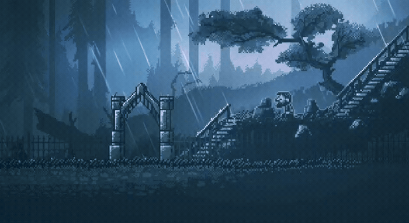

<div align="center">



<br/>


<br/>


<br/><br/>

<a href="https://www.linkedin.com/in/apoorva-puranik-62702b273/">

</a>
<a href="mailto:papoorva25@gmail.com">

</a>
<a href="https://github.com/Oriacgz">

</a>
<a href="https://www.instagram.com/oriacgzz/">

</a>

<br/><br/>


</div>

---

## 🌧️ About Me


```python
class Developer:
    def __init__(self):
        self.name = "Apoorva Puranik"
        self.role = "Software Engineer"
        self.location = "India"

        self.interests = [
            "Backend Engineering",
            "Artificial Intelligence",
            "Machine Learning",
            "Full Stack Development",
            "Cloud & DevOps"
        ]

        self.current_status = "Building & Learning"

    def philosophy(self):
        return "Build. Break. Learn. Repeat."
```

I'm **Apoorva Puranik**, an Information Technology undergraduate passionate about engineering reliable software and transforming ideas into real-world products.

My interests lie at the intersection of **Backend Engineering, AI/ML, Full Stack Development and Cloud Technologies**.

I enjoy building scalable APIs, designing database architectures, integrating intelligent systems, and developing software that solves meaningful problems.

Beyond programming, I explore **motion graphics, video editing, gaming, and creative technology**.

<br clear="right"/>

---

## ⚡ What I Do

<table>
<tr>
<td width="50%" valign="top">

### 🧠 AI / Machine Learning

- Machine Learning Models
- NLP & LLM Applications
- Intelligent Automation
- Model Evaluation & Optimization
- AI-Powered Applications

</td>
<td width="50%" valign="top">

### ⚙️ Backend Engineering

- REST API Development
- Database Design
- Authentication & Authorization
- Scalable Application Architecture
- Server-Side Development

</td>
</tr>

<tr>
<td width="50%" valign="top">

### 💻 Full Stack Development

- React & Modern Frontend
- Node.js / Express
- Python-Based Applications
- API Integration
- Responsive Web Applications

</td>
<td width="50%" valign="top">

### ☁️ Cloud & DevOps

- Git & GitHub
- Docker & Linux
- CI/CD Fundamentals
- Cloud Deployment
- Development Automation

</td>
</tr>
</table>

---

## 🛠️ Tech Stack

<div align="center">

### Languages


<br/>

### Frontend


<br/>

### Backend & Databases


<br/>

### Cloud, DevOps & Tools


<br/>

### AI / ML


</div>

---

## 🤖 AI / ML Expertise

| Domain | Proficiency | Tools & Concepts |
|:---|:---:|:---|
| Machine Learning | ⭐⭐⭐⭐☆ | Scikit-learn, XGBoost, Classification, Model Tuning |
| Deep Learning | ⭐⭐⭐☆☆ | Neural Networks, TensorFlow, PyTorch |
| NLP & LLMs | ⭐⭐⭐⭐☆ | Transformers, Embeddings, RAG, LLM Integration |
| Data Engineering | ⭐⭐⭐☆☆ | Pandas, NumPy, Data Preprocessing |
| MLOps | ⭐⭐⭐☆☆ | Model Deployment, Docker, API Integration |

---

## 📊 GitHub Analytics

<div align="center">


<br/><br/>


</div>

---

## 📈 Contribution Activity

<div align="center">

<a href="https://github.com/Oriacgz?tab=overview">

</a>

<br/>

<sub>View my latest contributions and development activity on GitHub.</sub>

</div>

---

## 🐍 Contribution Snake

<div align="center">

<picture>
  <source media="(prefers-color-scheme: dark)" srcset="https://raw.githubusercontent.com/Oriacgz/Oriacgz/output/github-contribution-grid-snake-dark.svg"/>
  <source media="(prefers-color-scheme: light)" srcset="https://raw.githubusercontent.com/Oriacgz/Oriacgz/output/github-contribution-grid-snake.svg"/>
  
</picture>

</div>

---

## 🚀 Current Focus

```yaml
developer:
  name: Apoorva Puranik

  currently_learning:
    - Advanced System Design
    - Distributed Systems
    - Transformer Architectures
    - Cloud Native Engineering

  currently_building:
    - AI Integrated Applications
    - Full Stack Web Platforms
    - Scalable Backend Services
    - Personal Engineering Portfolio

  exploring:
    - Agentic AI
    - Retrieval Augmented Generation
    - MLOps Pipelines
    - Open Source Contributions

  open_to:
    - Software Engineering Internships
    - Backend Engineering Roles
    - AI / ML Engineering Roles
    - Open Source Collaboration
```

---

## 🎧 Beyond The Code

<div align="center">


</div>

When I'm not coding, you'll probably find me:

- 🎮 Playing competitive games
- 🎬 Creating edits and motion graphics
- 🎵 Listening to lo-fi and ambient music
- 🌧️ Enjoying rainy-night aesthetics
- 🧪 Experimenting with emerging technology

---

## 🤝 Let's Connect

<div align="center">


<br/>

<a href="mailto:papoorva25@gmail.com">

</a>
<a href="https://www.linkedin.com/in/apoorva-puranik-62702b273/">

</a>
<a href="https://github.com/Oriacgz">

</a>
<a href="https://www.instagram.com/oriacgzz/">

</a>

<br/><br/>

**"Build. Break. Learn. Repeat."**

<br/>


<sub>Designed with code, coffee, and a little bit of rain.</sub>

</div>
